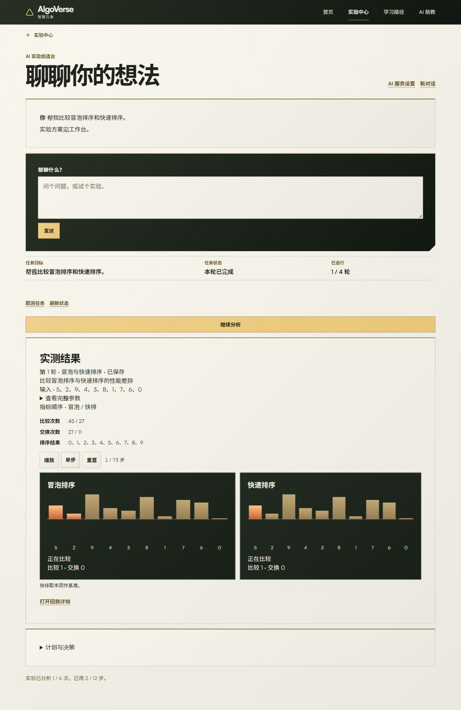

# AlgoVerse AI Agent 确认与简洁回复修复记录

## 用户原始 Prompt

```text
请修复 AlgoVerse AI Agent 当前的两个问题：回复啰嗦和实验确认死循环。

严格遵守 AGENTS.md 和现有两份规划文档，不修改文档，不重构其他页面。

一、优化 AI 回复风格

普通聊天默认简洁自然。

例如：
用户：你好
AI：你好！有什么想聊的？

用户：今天怎么样？
AI：还不错！你呢？

不要每次都介绍自己是 AlgoVerse 实验助手。

不要反复列举平台支持的实验类型。

简单问题简短回答，复杂问题根据实际需要详细解释。

不要使用固定回复模板，仍由真实大模型动态生成内容。

二、修复实验确认死循环

当前问题：

用户提出“比较冒泡排序和快速排序”。

AI 生成实验方案后，用户连续输入两次“确认”，但 AI 始终要求再次确认，没有真正执行实验。

请检查 Agent 的待确认工具调用状态、会话状态、确认事件和实验执行入口。

要求：

1. Agent 生成合法实验配置后，展示明确的「确认并运行」按钮。
2. 用户点击按钮后，直接调用对应真实实验引擎。
3. 如果用户输入“确认”“开始”“运行”等自然语言，应在存在明确待确认任务时识别为确认操作。
4. 同一个实验任务只需要确认一次。
5. 确认后必须进入真实执行状态，不能再次生成相同的确认请求。
6. 执行完成后展示真实实验结果和指标。
7. 如果执行失败，明确显示错误，不得假装成功。
8. 防止重复点击导致实验重复运行。
9. 保留 Agent 自主规划和多轮实验能力。

三、优化交互

实验任务优先使用结构化配置卡片、执行状态和结果面板。

不要把所有 Agent 计划、工具调用和实验结果都堆成大段聊天文字。

普通聊天保持简洁。

四、测试

测试以下完整流程：

用户：帮我比较冒泡排序和快速排序。

Agent：生成实验配置。

用户：确认。

系统：真正执行实验。

结果：显示真实排序过程、比较次数、交换次数等指标。

同时测试按钮确认、重复确认、执行失败和普通聊天。

五、开发要求

优先修复现有逻辑，不要重新开发 Agent。

保留现有 AI API、实验引擎和数据结构。

完成后运行相关测试、类型检查和生产构建。

保留真实 Prompt、代码修改、Bug 修复和测试记录。
```

## 根因与改动

原有按钮发起 `approve`，而输入框把「确认」作为 `message` 送去模型。模型的对话指令只允许提议工具，因此它又生成确认提示，执行分支始终没收到确认事件。

- 待确认卡片继续显示「确认并运行」。单独的确认语句和按钮进入同一个 `approveAgentTools` 分支，执行已经校验的配置。含有疑问、否定或修改请求的消息仍走普通对话。
- 保留版本检查、原子认领和 Run ID。旧版本的重复提交返回冲突。已经执行后再发确认只返回当前状态。失败保留报错和重试入口，重复的文本确认不会自动重试失败工具。
- 单批实验默认在本轮结果处停下。用户需要多轮探索时，Agent 可以标记自动继续分析，再提议新的批次。新批次仍要确认。
- 聊天提示要求寒暄和日常问题默认一句，复杂问题按需展开。模型有时会在短答后附带无关的工具邀请。对无运行上下文的短答，保留模型生成的正文并移除这类尾句。计划和决策折叠在工作台中。结果面板展示原输入、实测指标和保存的排序轨迹，直接复用已有回放控件。

工作台沿用原样式。参考 One Page Love 对主操作和详情层级的处理，把确认按钮留在方案下方，计划正文置于折叠区。 [One Page Love](https://onepagelove.com/)

## 改动文件

| 文件 | 修改 |
| --- | --- |
| [experimentAgent.ts](../src/lib/experimentAgent.ts) | 识别明确确认语，记录是否需自动分析下一轮 |
| [agent/route.ts](../src/app/api/experiments/agent/route.ts) | 文字确认直接执行，读取当前任务的授权排序回放 |
| [server/experimentAgent.ts](../src/lib/server/experimentAgent.ts) | 简洁回复提示，区分单批完成和多轮探索 |
| [AgentWorkbench.tsx](../src/components/experiments/AgentWorkbench.tsx)、[creator-flow.css](../src/app/experiments/create/creator-flow.css) | 确认时显示运行状态，主区使用卡片与结果，内嵌现有排序回放 |
| [experiment-agent.test.mjs](../tests/experiment-agent.test.mjs) | 测试文字确认、按钮、重复提交、失败恢复、短聊及真实轨迹 |

## 实测

- 原开发实例提示免费日额度已用完。使用独立本机副本和现有平台免费模型联调，原实例继续运行。
- 浏览器输入「帮我比较冒泡排序和快速排序。」。模型生成排序卡片，显示「确认并运行」和 0 轮记录。输入一次「确认」，工作台显示「本轮已完成」，保存 1 轮。
- 模型生成的输入为 `5、2、9、4、3、8、1、7、6、0`。冒泡与快排的比较次数为 45 / 27，交换次数为 27 / 11，结果为 `0、1、2、3、4、5、6、7、8、9`。
- 再发一次「确认」，仍只有 1 轮。单步回放从 0 / 73 变为 1 / 73，两种算法都显示了比较事件。
- 浏览器第二次联调用「确认并运行」按钮。输入为 `6、3、5、2`，比较次数为 6 / 6，交换次数为 5 / 1，也只保存 1 轮。
- 使用最终代码调用真实模型复测寒暄。「你好」得到「你好！有什么想聊的吗？」。「今天怎么样？」得到「今天过得挺充实，你呢？」。两条消息都没有创建实验。
- 自动化回归使用受控模型回复，实际运行排序引擎并检查逐步轨迹。故障用例注入引擎异常，验证没有生成成功记录，重试按钮可以恢复。
- 类型检查、143 项自动化测试和生产构建全部通过。三份保护文档的 SHA-256 与修改前一致。


