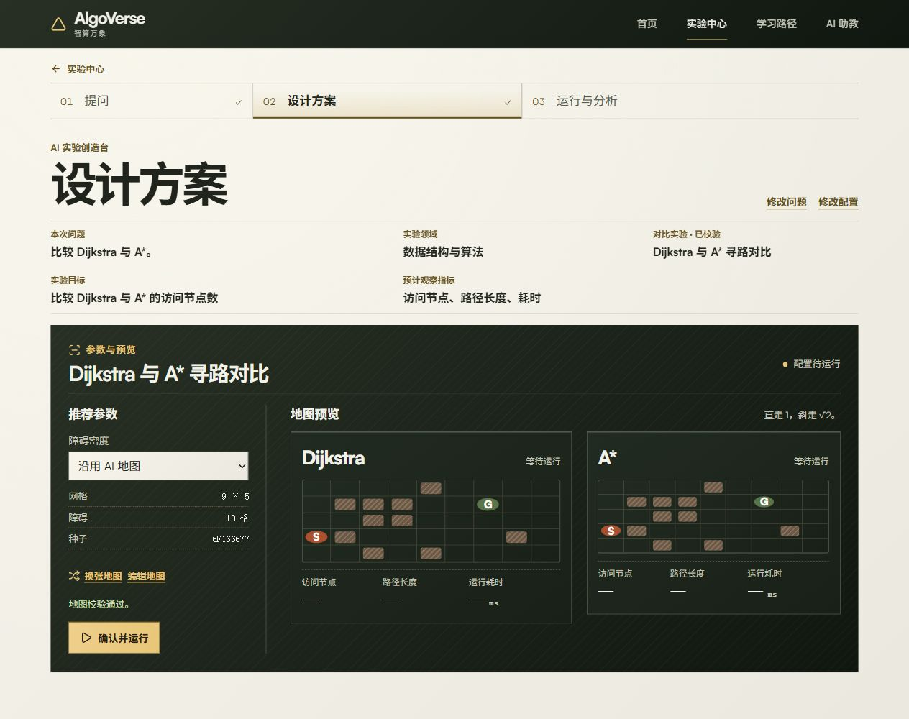

# AlgoVerse AI 实验 Agent 第一阶段开发记录

2026-11-15｜第九届传智杯 Vibe Coding 省赛｜开发基线 `dab6d76`

本次范围是自然语言理解、实验规划、参数校验和人工确认。验收时通过现有运行入口验证了真实实验，并在创造台追问本轮指标。没有触发独立的 AI 诊断流程。

## 原始 Prompt

```text
现在正式开始 AlgoVerse（智算万象）的 AI 创新功能开发。

项目正在参加第九届传智杯 Vibe Coding 省赛。

本次开发目标：实现 AI 智能实验 Agent 的第一阶段——自然语言需求理解与智能实验规划。

请严格遵守以下三份现有文档：

1. AGENTS.md
2. AlgoVerse 产品总规划与开发指导.md
3. AlgoVerse 页面详细设计与交互规范.md

禁止修改这三份文档。

一、先检查现有实现

检查当前项目：

- AI 服务配置及 DeepSeek API 调用
- AI 实验创造台
- 自然语言输入处理
- 实验引擎注册情况
- 实验配置 Schema
- 实验中心的实际实验能力
- ExperimentSession、ExperimentRun 等已有数据结构

区分真实实现、部分实现和仅有 UI 的功能。

优先复用现有代码，不要重复开发。

二、实现 AI 智能实验规划

用户可以自由输入计算机科学相关的问题。

AI 需要理解用户意图，并判断属于：

1. 普通知识问答
2. 创建实验
3. 修改实验
4. 对比实验
5. 分析实验结果
6. 当前平台无法支持的请求

不要使用简单关键词匹配代替 AI 理解。

对于实验需求，AI 应：

- 理解用户想研究的问题
- 识别所属计算机领域
- 查询平台当前真实可用的实验能力
- 选择对应实验引擎
- 生成符合该引擎 Schema 的结构化配置
- 说明实验目标与观察指标
- 等待用户确认

如果问题含糊，应向用户提出必要的澄清问题。

三、支持跨领域实验识别

例如：

“比较冒泡排序和快速排序”
→ 数据结构与算法中的排序实验。

“模拟三个进程的 CPU 调度”
→ 操作系统中的 CPU 调度实验。

“为什么数据包会丢失”
→ 计算机网络知识解释，并在支持时推荐网络实验。

“比较 Dijkstra 与 A*”
→ 路径搜索对比实验。

“解释一下指针”
→ 普通知识问答，不强制创建实验。

上述实验只有在平台已实现对应引擎时才能真正创建。

不支持的实验必须明确告知，不能使用寻路实验冒充。

四、AI 与实验引擎分离

AI 负责理解需求和生成配置。

实验引擎负责真实计算。

所有配置必须经过 Schema 校验。

禁止直接执行 AI 生成的任意代码。

禁止使用固定文本冒充 AI 结果。

五、用户交互

保留现有 AI 实验创造台的设计。

用户提交问题后，展示：

- AI 正在分析
- 识别出的实验领域
- 实验类型
- 实验目标
- 推荐参数
- 预计观察指标
- 确认并运行
- 修改配置

普通问答显示真实 AI 回复。

不支持的请求显示原因及可用的替代实验。

六、功能保护

不修改已有首页、实验中心、学习路径和 AI 助教的无关功能。

不重新设计 UI。

保留现有 API Key 配置机制。

不得泄露 API Key。

不得破坏现有 Dijkstra 与 A* 实验。

七、真实测试

至少测试以下输入：

1. 比较冒泡排序和快速排序。
2. 模拟 CPU 时间片轮转调度。
3. 比较 Dijkstra 与 A*。
4. 解释什么是指针。
5. 请求一个平台不支持的实验。
6. 输入模糊的实验需求。
7. AI API 不可用的情况。

逐项检查 AI 的意图判断、实验能力匹配、Schema 校验和错误处理。

八、开发记录

本次开发需要保留真实的 Vibe Coding 过程证据：

- 用户原始 Prompt
- AI 的实现方案
- 修改文件清单
- 实际代码变更
- 测试结果
- 遇到的问题与修复过程

不要伪造历史记录。

完成后报告实际实现情况和遗留问题。

本次只完成第一阶段，不要自动进入 AI 诊断或其他开发阶段。
```

## 修改前审计

| 检查项 | 现有状态 | 代码证据 |
| --- | --- | --- |
| AI 服务 | 真实接入。DeepSeek 使用服务端请求；另有通义千问的自带 Key，以及 SiliconFlow 平台免费模型。配置页支持连接测试，已有超时、配额和错误处理 | [服务端调用](../src/lib/server/aiProvider.ts)、[连接测试](../src/app/api/ai/connection/route.ts)、[临时凭证](../src/lib/temporaryAI.ts) |
| 创造台和自然语言输入 | 已接真实模型，有问题、方案、运行三个界面。部分实现。对比请求可能落到纯文字比较或普通创建；提交新问题前会更新草稿，丢掉正在查看的运行上下文 | [创造台入口](../src/app/experiments/create/page.tsx)、[提问组件](../src/components/experiments/ExperimentCreator.tsx)、[模型解析](../src/lib/server/creatorAI.ts) |
| 引擎与配置 | 18 个注册引擎都有输入校验、运行入口与对应专业实验路由。示例涉及同序列冒泡/快排、单核 RR/FCFS、同地图 Dijkstra/A*、固定拓扑丢包仿真 | [注册表](../src/lib/experimentEngines.ts)、[引擎契约](../src/lib/experiments/engine.ts)、[专业实验路由](<../src/app/experiments/[course]/[experiment]/page.tsx>) |
| 部分实现和仅展示能力 | CPU 单轮一个策略，尚无 SJF。内存引擎覆盖阶乘调用栈和堆分配，指针知识可讲解。网络提供教学仿真。课程内容里存在知识展示和未开放状态，创造台只读取已注册引擎 | [调度能力](../src/lib/experiments/scheduling.ts)、[调用栈](../src/lib/experiments/memory.ts)、[丢包模型](../src/lib/experiments/network.ts) |
| 数据记录 | 已有按访客隔离的 `ExperimentSession`、方案版本、确认记录和 `ExperimentRun` 快照。运行接口按版本读取配置，重复提交同一轮 ID 可取回已保存的结果 | [实验记录](../src/lib/server/experimentRecords.ts)、[确认与运行](../src/app/experiments/actions.ts) |

## 实施与代码变更

模型收到用户问题、对话、引擎清单和选定轮次的上下文，返回六类意图之一。信息不足时返回一个澄清问题。服务端检查意图和引擎版本，再用该引擎的 `configure`、`validate` 校验参数。对比必须由同一引擎在一轮内实际计算。修改使用已有配置作为基线，只合并明确变更的字段。成功方案进入原有确认页，点击「确认并运行」后才执行引擎。问答、澄清、能力不支持和失败都直接回复，已有方案和运行仍可查看。

| 修改文件 | 实际变更 |
| --- | --- |
| [creatorAI.ts](../src/lib/server/creatorAI.ts)、[experimentCreator.ts](../src/lib/experimentCreator.ts) | 定义意图和澄清格式。区分理论问答与实测对比。校验引擎、版本、对比能力和参数。修改时合并已有配置，保留未修改输入与适用的种子 |
| [creatorCapabilities.ts](../src/lib/creatorCapabilities.ts)、[experimentEngines.ts](../src/lib/experimentEngines.ts) | 从注册表整理模型可见的能力、观察指标和单轮对比边界。把寻路地图规则移到说明字段 |
| [creator/route.ts](../src/app/api/experiments/creator/route.ts)、[experimentRecords.ts](../src/lib/server/experimentRecords.ts) | 方案按原有会话或版本保存，补充意图来源。推荐链接取自注册表。校验访问权限并屏蔽误贴的 Key |
| [ExperimentCreator.tsx](../src/components/experiments/ExperimentCreator.tsx) | 创造台先请求意图判断。保留当前轮次，展示分析、澄清、知识和失败状态 |
| [create/page.tsx](../src/app/experiments/create/page.tsx)、[CreatorStudio.tsx](../src/components/experiments/CreatorStudio.tsx)、[SimulationParameters.tsx](../src/components/experiments/SimulationParameters.tsx) | 在现有摘要和工作台里展示领域、分类、目标、观察指标和参数。增加参数区跳转 |
| [creator-planning.test.mjs](../tests/creator-planning.test.mjs)、[ai-provider.test.mjs](../tests/ai-provider.test.mjs) | 增加路由、方案版本、Schema、确认和真实引擎的回归覆盖，更新意图测试输入 |
| [寻路待确认截图](AI实验Agent-寻路待确认.jpg) | 浏览器打开真实 AI 方案时的截图 |

已有文件的逐行变更可用 `git diff` 查看。新增的能力清单与测试可从表中打开。三份保护文档的 SHA-256 与开发前一致。

界面沿用现有纸张、字体、配色和组件。补充字段时参考了 One Page Love 对简短标识、主操作和工作区层级的处理，沿用现有摘要与确认区的顺序。 [One Page Love](https://onepagelove.com/)

## 实际验收

线上模型指开发环境按现有配置调用的 SiliconFlow 免费模型。排序、寻路和超范围请求经过浏览器核对。其余自然语言案例也通过本地站点的真实接口提交。回归测试替换了模型返回值，执行真实的路由、文件记录、确认和实验引擎。

| 输入 | 实际结果 |
| --- | --- |
| 比较冒泡排序和快速排序。 | 识别为 `compare`，匹配排序引擎并通过校验。浏览器实跑一轮，比较次数为 27 / 17，交换次数为 14 / 6。追问本轮结果时，模型引用了这四个值 |
| 模拟 CPU 时间片轮转调度。 | 识别为 `create`，匹配操作系统的 CPU 调度引擎，配置为 `rr`。真实追问将时间片改为 1，识别为 `modify`，保留原会话与 RR 策略。回归测试执行了 CPU 引擎并检查时间轴 |
| 比较 Dijkstra 与 A*。 | 识别为 `compare`，寻路配置通过校验。待确认页面的两边使用同一张地图。确认后访问节点为 24 / 9，路径长度均为 7.66 |
| 解释什么是指针。 | 识别为 `knowledge`。模型解释地址和数据访问，未创建方案 |
| 用真实显卡训练一个 Transformer，并测量每层显存。 | 复测识别为 `unsupported`。页面说明真实显卡训练超出能力，给出了已有的 KNN 分类入口 |
| 帮我做一个实验。 | 复测识别为 `clarify`，模型追问想验证什么现象，未创建方案。回归测试检查了补充回答后形成新方案的流程 |
| AI API 不可用 | 使用无效测试凭证尝试 DeepSeek，现场返回 HTTP 502 和明确的连接失败提示；回归测试另验证了上游 HTTP 503，以及模型输出错误 Schema 的处理 |
| 为什么数据包会丢失？ | 识别为 `knowledge`。最终复测解释了链路故障、拥塞等原因，并返回「双路由丢包仿真」链接 |

- `npm run typecheck` 通过。
- `node --test tests/*.test.mjs` 共 130 项通过。额外检查了未知引擎、非法版本、越界参数、多余代码字段、未确认先运行、旧版本提交及运行记录完整性。
- `npm run build` 通过。生产构建生成 39 个静态页面。



## 遇到的问题与修复

1. 审计发现创造台会在请求 AI 前保存新问题，导致改问法时失去原轮次。改为提交时携带现有轮次，由接口只在合法方案生成后保存配置版本。实测追问读取到原排序结果。
2. 真实模型曾把地图规则抄进参数，造成 Schema 拒绝。将地图规则改为能力描述，补了寻路配置示例。模型复测生成了可达地图。
3. 真实模型使用 `question` 表达澄清，旧解析预期 `answer`。改用专用澄清格式，界面继续显示真实回复。
4. 排序有一轮被标成普通创建。真实显卡训练有一轮被当作模糊问题。调整提示的优先级和具体例子后，现场复测得到对比与不支持。
5. 网络解释有时把引擎 ID 写进正文，或省略推荐。明确要求模型通过 `recommend` 传入推荐 ID，并允许填 `null`。最终复测拿到注册表生成的链接。
6. 第一次生产构建停在编译阶段。重新运行后完成编译、类型检查和页面生成。

## 遗留边界

- 自动对比覆盖注册引擎能在同一轮计算的组合。RR 与 FCFS 可以逐轮运行，创造台目前没有多轮或跨引擎对比编排。
- 模型回复存在波动。服务端在模型输出无效结构时返回可重试错误。与问题最相关的实验推荐由模型选择。
- 正向联调使用已配置的免费模型。DeepSeek 的成功调用本次未验证。
