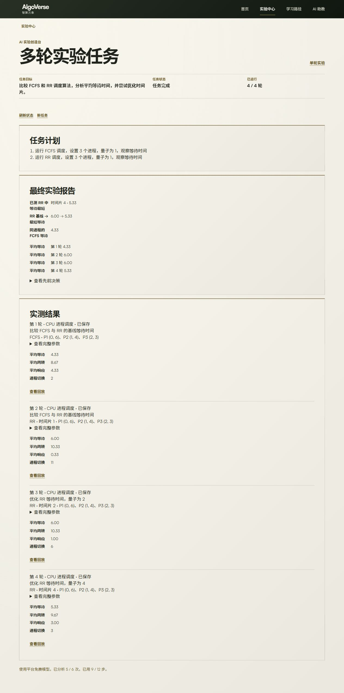

# AlgoVerse AI 实验 Agent 第二阶段开发记录

2026-11-15｜第九届传智杯 Vibe Coding 省赛

## 用户原始 Prompt

```text
现在开始 AlgoVerse 智算万象 AI 创新开发第二阶段。

注意：本阶段目标不是开发一个普通的 AI 诊断按钮，而是实现真正具有自主规划、工具调用、结果观察和多轮决策能力的「AI 实验 Agent」。

第一阶段已经报告实现 AI 意图识别、跨领域实验匹配和结构化配置生成。

请严格遵守 AGENTS.md、产品总规划与页面交互规范，不修改这三份文档。

一、检查现有 Agent 基础

检查现有 AI 规划器、18 个已注册实验引擎、配置 Schema、ExperimentSession、ExperimentRun 和 Diagnosis。

核实哪些实验引擎真实可运行，哪些只是注册信息或页面入口。

优先复用现有功能，不重写已经完成的第一阶段。

二、实现 Agent 任务规划

用户可以提出具有目标的任务，例如：

“比较 FCFS 和 RR 调度算法，分析等待时间差异，并尝试寻找更合适的时间片。”

Agent 应：

1. 理解最终目标。
2. 识别所需实验能力。
3. 制定可执行的步骤计划。
4. 选择已注册且真实可运行的工具。
5. 为每个步骤生成合法参数。
6. 展示任务计划和执行状态。

计划必须根据任务和工具能力动态生成，不允许仅用固定模板冒充自主规划。

三、实现受控工具调用

将现有真实实验引擎封装为 Agent 可调用的工具。

工具应有明确的名称、输入 Schema、输出 Schema 和错误处理。

Agent 只能调用白名单中的真实工具。

禁止执行 AI 任意生成的代码。

工具执行前必须校验参数和权限。

对于需要用户确认的操作，必须先获得确认。

四、实现观察与决策循环

Agent 调用实验工具后，读取真实运行结果。

根据实际指标和任务目标判断：

- 是否已经完成任务。
- 是否需要解释结果。
- 是否需要修改实验参数。
- 是否需要运行下一轮实验。
- 是否需要向用户澄清。

如果需要下一轮，Agent 应提出具体的新参数及理由。

用户确认后才能继续执行。

不得通过预设固定步骤冒充自主决策。

五、实现多轮实验与结果对比

每轮实验生成独立 ExperimentRun。

保留配置、运行轨迹、真实指标和执行状态。

Agent 能比较不同 Run 的结果，并解释参数变化对结果的影响。

所有结论必须基于真实数据。

六、实现 Agent 执行过程可视化

在现有实验工作台中展示：

- 当前任务目标
- Agent 规划步骤
- 当前调用的实验工具
- 工具执行状态
- 实际返回结果
- Agent 观察与决策
- 下一轮建议
- 最终实验报告

保留现有艺术拼贴 UI，不重构首页和实验中心。

七、安全与执行限制

1. 设置最大 Agent 步骤数。
2. 设置最大实验运行轮数。
3. 设置 API 请求和成本上限。
4. 支持取消与失败重试。
5. 不允许无限循环。
6. 不允许未经确认自动执行有风险的操作。
7. 不允许伪造 AI 推理、工具调用或实验结果。
8. 不向前端日志暴露 API Key。

八、验收案例

输入：

“比较 FCFS 和 RR 调度算法，分析平均等待时间，并尝试优化时间片。”

期望 Agent 能：

1. 理解目标。
2. 制定实验计划。
3. 选择真实 CPU 调度引擎。
4. 生成合法配置。
5. 用户确认后运行。
6. 读取真实指标。
7. 分析两种调度算法的差异。
8. 根据结果提出下一轮参数调整。
9. 用户确认后再次运行。
10. 对比两轮真实结果并生成报告。

如果现有 CPU 调度引擎不具备必要能力，先说明缺失项，不得假装成功。

九、开发记录与测试

保留本次真实 Prompt、AI 修改方案、工具调用实现、代码变更、测试结果和 Bug 修复过程。

运行类型检查、相关测试和生产构建。

完成后输出：

- 实际实现的 Agent 能力
- 可调用的真实实验工具清单
- 成功运行的端到端案例
- 仍未实现的能力
- 具体修改文件
- 测试结果

本次只开发 Agent 第二阶段，不自动进入其他开发任务。
```

## 开发前核查

- 第一阶段创造台通过真实模型完成意图理解和单轮方案，实验对比限于单个引擎在一次执行内能输出的组合。第一阶段代码在工作区，第二阶段在此基础上增加独立任务入口。
- 所有 18 个注册引擎有实际输入校验、运行入口、指标和对应实验页。测试用各自的预设配置运行，逐一读取了真实引擎输出。知识页和未开放项目不进入工具清单。
- CPU 引擎支持单核 FCFS 和 RR，每轮接受一种策略。它输出执行时间轴、进程指标、平均等待、平均响应、平均周转和切换次数。本次通过多轮实现对比和时间片试验。
- `ExperimentSession` 保存配置，`ExperimentRun` 保存不可变的配置与轨迹。原有 `Diagnosis` 关注一个既有 Run，由模型选择该轮的证据。本次 Agent 引用多个 Run，由任务状态控制执行。

## 方案和执行限制

任务提交后，模型读取目标、白名单和已有实测指标，再决定提议工具调用、追问、结束或说明不支持。工具提议为 `{ tool, parameters }`。服务端解析工具名称、固定对应版本、校验引擎配置并存下待确认方案。用户确认的是当时保存的整批参数。任何后续方案重新等待确认。

每项工具从现有引擎注册信息取得名称、输入描述和输出指标描述。输入用引擎自身的 `configure` 和 `validate` 检查。确认后走现有会话、确认记录和运行入口。工具输出校验 Run 身份、引擎版本、结果类别和允许的指标键，再把已保存的指标交给模型。每轮的独立 Run 可沿现有实验页面回放。

模型选择报告的轮次和指标。服务端确认引用存在，报告用记录中的数值算差值。同一进程输入下的 RR 等待比较也由程序计算，包含并列情况。观察区的下一轮理由来自模型真实回复，报告结论来自运行数据。

- 每项任务最多 12 步、6 次模型请求、4 次实验运行。每批最多 2 个工具调用。每次模型输出上限是 1000 Token。失败的尝试计入对应预算。
- Agent 使用现有的 SiliconFlow 免费主模型，每次调用前核验输入和输出价格为零。价格无法确认时停止。此入口不接受自带付费 Key，也不在同一次分析中自动切换模型。
- 访客 Cookie 限制任务和 Run 的访问。确认使用已保存版本，原子写入阻止并发重复执行。错误可重试，并保留已经完成的 Run。
- 可以取消待确认或分析中的任务。取消后迟到的分析不能写回。已经确认的短时本地工具批次会先结束。

## 可调用工具

| 领域 | 工具 |
| --- | --- |
| 数据结构与算法 | `pathfinding` 寻路、`sorting` 排序、`hash-collisions` 哈希冲突、`tree-traversal` 树遍历、`graph-traversal` 图遍历 |
| 操作系统 | `cpu-scheduling` CPU 调度、`page-replacement` 页面置换、`deadlock-avoidance` 死锁避免 |
| 计算机网络 | `network-transmission` 丢包仿真、`tcp-congestion` TCP 拥塞控制、`dynamic-routing` 动态路由 |
| 程序设计与内存 | `memory-visualization` 递归调用栈、`memory-allocation` 堆分配 |
| 数据库原理 | `b-plus-tree` B+ 树、`transaction-concurrency` 事务并发 |
| 人工智能基础 | `knn-classification` KNN、`k-means` 聚类、`gradient-descent` 梯度下降 |

## 浏览器端到端实测

在「多轮实验任务」提交指定的 FCFS 与 RR 目标。真实模型提出两组同输入的基线。首次确认前运行数为零。确认后，Agent 读到实际指标，提出 RR 时间片 2 和 4。再次确认后生成另外两条记录。四轮都用 P1（0，6）、P2（1，4）、P3（2，3）。每一对数字是到达与运行时间。

| 轮次 | 策略 | 平均等待 | 平均响应 | 平均周转 | 进程切换 |
| --- | --- | ---: | ---: | ---: | ---: |
| 1 | FCFS | 4.33 | 4.33 | 8.67 | 2 |
| 2 | RR 时间片 1 | 6.00 | 0.33 | 10.33 | 11 |
| 3 | RR 时间片 2 | 6.00 | 1.00 | 10.33 | 6 |
| 4 | RR 时间片 4 | 5.33 | 3.00 | 9.67 | 3 |

已测 RR 中，时间片 4 的平均等待最短，较 RR 基线少 0.67 个模拟刻度。这组进程的 FCFS 平均等待仍更短。试验结果只描述这批进程和试过的时间片。



最终代码又用真实模型经同一个任务接口完整跑了一次。Agent 在同一组进程上依次选择 FCFS 和 RR 1 作基线，然后尝试 RR 2 和 RR 3。四轮平均等待为 4.33、6.00、6.00、6.00。模型曾在只剩一轮时提议三组参数，校验拒绝了整批。重试只提交一组。最后真实模型返回 `finish`，引用第 1 和第 4 轮的平均等待，该任务保存为完成。该次试验没有找到更低的 RR 平均等待。

## 实际代码变更

| 文件 | 变更 |
| --- | --- |
| [experimentAgent.ts](../src/lib/experimentAgent.ts) | 任务结构、执行预算与 CPU 报告计算 |
| [server/experimentAgent.ts](../src/lib/server/experimentAgent.ts) | 动态规划、实测观察、校验模型决策、确认执行、澄清和取消 |
| [agentTools.ts](../src/lib/server/agentTools.ts) | 18 个引擎的工具适配、输入与输出契约 |
| [experimentRecords.ts](../src/lib/server/experimentRecords.ts) | 访客隔离的任务版本。借用现有确认与 Run 保存 |
| [aiProvider.ts](../src/lib/server/aiProvider.ts) | 新增 Agent 调用种类。每次仅调用指定免费模型 |
| [scheduling.ts](../src/lib/experiments/scheduling.ts) | 明确 FCFS 的时间片字段范围，保持原调度规则 |
| [agent/route.ts](../src/app/api/experiments/agent/route.ts) | 任务、确认、分析、状态和取消接口 |
| [AgentWorkbench.tsx](../src/components/experiments/AgentWorkbench.tsx)、[create/page.tsx](../src/app/experiments/create/page.tsx)、[creator-flow.css](../src/app/experiments/create/creator-flow.css) | 在现有创造台增加多轮模式，展示计划、待确认参数、回放和报告 |
| [experiment-agent.test.mjs](../tests/experiment-agent.test.mjs) | 工具验真、端到端数据、输入失败、取消、审批竞态和请求上限 |

界面沿用现有艺术拼贴风格。参考 One Page Love 的页面层级，将任务和主操作置于上方，下方依次呈现计划和实测证据。 [One Page Love](https://onepagelove.com/)

## Bug 与修复

1. 本地浏览器首次提交被同站校验拦下。Next.js 在请求 URL 中用了不同的本机主机名。校验改用实际 Host，并保留来源限制。
2. 免费模型首次给 FCFS 填了时间片 0，计划也超长。运行前校验拒绝了方案。补齐参数约束和步骤上限提示后，真实回复生成了有效基线。
3. 观察阶段的模型曾把工具理由放错层级。调用结构缩减为工具与参数，理由统一显示在 Agent 决策区。复测成功生成两组新时间片。
4. 模型的早期报告把响应时间变化说反。最终改由程序从已保存指标计算报告，模型只选择证据和完成时机。重新打开现场任务，报告显示已测 RR 最短等待 5.33 和 FCFS 4.33。
5. 自动化用例最初手填了错误的预期等待值。按引擎时间轴复算后，修正断言并重新验证。
6. 追加真模型复测期间出现超时和结构拒绝。将规划、观察、额度用尽后的报告提示按任务阶段拆开，重试时带上上次错误。最终接口复测到达完成态。

## 验证和剩余边界

- `npm run typecheck`、`node --test tests/*.test.mjs`、`npm run build` 全部通过。135 项自动化测试通过，其中第二阶段增加 5 项。自动化测试替换模型返回值，运行真实工具和记录逻辑。浏览器验收另用真实模型。
- 三份保护文档的 SHA-256 与开发前一致。阶段一的现有测试也在 135 项之内。
- 真实端到端验收覆盖 CPU 调度。其余 17 个引擎逐个验证了预设配置和计算输出。
- Agent 目前只在单任务预算内探索。CPU 仅支持单核 FCFS 与 RR。结论限定在已有真实记录，模型超时或返回不合法内容时可以重试。
